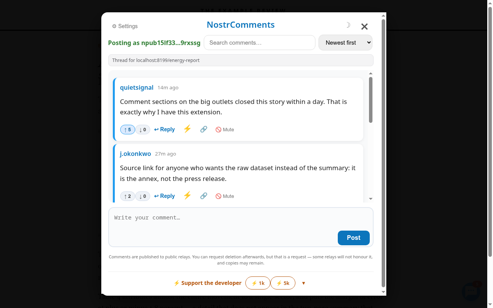

# NostrComments

**The comment section no website can close.**

<p align="center">
  
</p>

NostrComments adds a comment thread to every web page. The thread lives on public
[Nostr](https://nostr.com) relays, not on the site, so the site cannot remove it — and there is no
server of ours in between. No account, no email, no tracking.

**Install:** [Firefox](https://addons.mozilla.org/en-US/firefox/addon/nostrcomments/) ·
[Chrome, Brave, Edge](https://chromewebstore.google.com/detail/nostrcomments/ebmgdpicceaencegknannfaljhbfgido)  
**Try it first:** [read any page's thread without installing anything](https://briskness-byte.github.io/thread/) ·
[watch the 66-second demo](https://www.youtube.com/watch?v=bywF8yWZa3o)  
**Run a site?** [Show its thread under your articles](https://briskness-byte.github.io/embed/)

## What it is for

- **Warning the next visitor** — a shop that never delivered, a seller who vanished, an offer that is
  too good to be true. One comment already helps the next person, even if nobody ever replies.
- **Discussing the news** on sites that closed their comment section.
- **Adding context** to a company announcement, a government page or a press release.

That matters most where it is least welcome: on a news site that closed its comments, on a
government page, on a corporate announcement, on an article in a country where disagreeing in
public is expensive. The thread is attached to the page's address, not hosted by the page's owner,
so it stays reachable whether or not they want it to exist.

**More ways in:**

- **[The reader](https://briskness-byte.github.io/thread/)** — a static page that queries the same
  relays from your own browser and checks every comment's signature. Give it any address to see what
  has been said about it.
- **[The embed](https://briskness-byte.github.io/embed/)** — a snippet a site owner pastes once,
  read-only, that loads nothing until a visitor clicks. Readers see the comments without installing
  anything. The owner cannot moderate it, and the page says so up front.
- **[The demo](https://www.youtube.com/watch?v=bywF8yWZa3o)** — sixty-six seconds: a thread on an
  article that has no comment section, the same thread in a second browser under a different key,
  then a paywalled paper, a company announcement, a government page and a post on X.

In active development since December 2025, with new releases most weeks.

## Privacy

NostrComments has **no server**. There is no account, no email, no telemetry, and no analytics
of any kind — the developer never receives your data, because there is nowhere for it to go.

Because the extension can run on every page you visit, that claim deserves proof rather than
trust. The short version:

- **Nothing is transmitted until you explicitly enable it.** On first use you get a disclosure
  screen; no relay is contacted before you accept it, and you can disable NostrComments per site
  at any time.
- **Your private key never leaves your device.** It is used only to sign events, and can
  optionally be encrypted at rest with a password (PBKDF2 + AES-GCM).
- **Only what you choose to publish is published**: your comment or vote and your public key —
  sent to the public relays you have configured, not to us.
- **But the relays do see which pages you read.** Finding a thread means asking them about a
  page, so the relays you choose learn the URL and your IP address. That is inherent to a comment
  system attached to URLs rather than a choice made for you, and since v22.53 it applies only to
  pages you actually read — never to a tab you did not look at or a page you left in a second.
  The relay list is yours: remove any you do not trust, or run your own.

The full policy is in **[PRIVACY.md](PRIVACY.md)**.

## Features

- **Works on any website** — news, blogs, paywalled content, anything
- **No account required** — generate a keypair in one click, or connect an existing Nostr wallet
- **Truly decentralised** — comments are stored on public relays, not our servers
- **Profile avatars** — fetches Nostr profile pictures and display names
- **Dark mode** — toggle between dark and light mode, or follow system preference
- **Upvote / downvote** — community-driven auto-hide for low-quality comments
- **Delete your own comment** — publishes a NIP-09 request; relays that honour it drop it
- **Mute users** — hide comments from specific users permanently
- **Mute words** — hide any comment containing a word or phrase you choose
- **"New" badges** — comments posted since your last visit to a page are marked
- **Reply notifications** — get notified when someone replies to your comment
- **Zaps** — tip a commenter over Lightning (NIP-57)
- **Portable identity** — copy your key as `nsec` / `npub` (NIP-19) for any other Nostr app
- **Resilient connections** — relays reconnect automatically with a capped backoff
- **Relative timestamps** — shows "2h ago", "3d ago", etc.
- **Inline media** — images and videos embedded directly in comments
- **Copy note link** — share a direct `nostr:` link to any comment
- **Custom relays** — add or remove relays from the Settings panel
- **Search and sort** — newest, oldest, most upvoted
- **Paginated** — loads 20 comments at a time
- **Share a comment to your feed** — publishes it as an ordinary note with a link back, so people
  who do not have this extension can still see what you wrote. Behind a confirm, and never automatic
- **Your threads** — Settings lists the pages you have commented on, because a comment is filed
  under one address and there was otherwise no way back to it
- **Repeated comments folded** — three or more near-identical comments from one key become one line
  with the rest a click away. Presentation only; nothing is blocked and nothing is hidden
- **Pictures can wait** — turn off *Load pictures automatically* and every picture and avatar waits
  behind the name of the host it would come from until you ask for it
- **The thread's address** — when it differs from your address bar, because an anchor or a campaign
  parameter was dropped, the panel says which address the conversation is filed under
- **Quiet mode** — hover the button and click the small −, and it only shows on pages that already
  have comments, or where somebody replied to you. Off by default, so you can still start a thread
  on a page nobody has commented on yet
- **The site speaks for itself** — with verified names on, a commenter whose checked NIP-05 is
  `_@example.com` is labelled "speaks for example.com" on that site's pages. It proves control of
  the domain, not authorship
- **Your history** — the toolbar button opens a page with the last 300 pages where you opened the panel,
  newest first, with a search and a Clear button. It stays on your device and makes no requests
- **One switch for every page** — the toolbar button has an On/Off switch. Off: nothing appears on
  any page, nothing connects to a relay, and your signer is not asked for anything, until you switch
  it back on. Open tabs follow at once
- **Your signer is asked when you open the panel**, not on every page you visit, so a signer that
  asks permission per site (like Attest) only asks where you actually read or write comments

## Installation

### Chrome / Brave / Edge

Install from the [Chrome Web Store](https://chromewebstore.google.com/detail/nostrcomments/ebmgdpicceaencegknannfaljhbfgido).

Or load it manually, without the store:

1. Download `NostrComments-Chrome-vX.Y.zip` from the [latest release](https://github.com/briskness-byte/NostrComments/releases/latest) and unzip it
2. Go to `chrome://extensions` → enable **Developer mode**
3. Click **Load unpacked** and select the unzipped folder

### Firefox

Install from [Firefox Add-ons](https://addons.mozilla.org/en-US/firefox/addon/nostrcomments/).

Or manually: download `NostrComments-Firefox-vX.Y.xpi` from the
[latest release](https://github.com/briskness-byte/NostrComments/releases/latest) and drag it into
Firefox, or open `about:addons` → gear icon → **Install Add-on From File**.

### Userscript (no longer updated)

The userscript is frozen at 23.2.0. It still works, but it gets no new features and no fixes. A
userscript has no background context, so it cannot open relay connections outside the page, and
on sites with a strict Content-Security-Policy (x.com among them) Firefox refuses them. Install
the extension instead. Details in
[NostrComments-Userscript/README.md](NostrComments-Userscript/README.md).

## Getting started

When you open the comment panel for the first time you will see a disclosure screen explaining
what gets sent where. After you accept it, the onboarding screen offers two options:

1. **Generate a key** — click *Start commenting — generate your key*. A keypair is created
   locally in your browser. Back it up from the ⚙ Settings panel — you can copy it as `nsec` to
   use the same identity in any other Nostr app — and consider setting a password to encrypt it
   at rest.
2. **Connect a wallet** — use [Alby](https://getalby.com) for signing via the NIP-07 browser
   extension standard, or a dedicated signer: [nos2x](https://github.com/fiatjaf/nos2x) on Chrome,
   [nos2x-fox](https://addons.mozilla.org/firefox/addon/nos2x-fox/) on Firefox. On Firefox there is also
   [Attest](https://addons.mozilla.org/firefox/addon/attest/), by the same developer as NostrComments, which can
   also sign through a remote signer such as nsec.app or Amber (NIP-46).

## Default relays

- `wss://nos.lol`
- `wss://relay.damus.io`
- `wss://relay.nostr.band`
- `wss://relay.primal.net`
- `wss://relay.snort.social`
- `wss://offchain.pub`

You can add or remove relays from the ⚙ Settings panel inside the extension.

## Development

No build system, no dependencies, no package manager. The extension is a single content script
per distribution, and the two distributions are kept in lockstep.

```sh
node tests/run.mjs         # run the test suite (Node 18+, no packages to install)
node tests/browser-qa.mjs  # drive the real extension in a browser (needs chromium + chromedriver)
sh build.sh                # produce the Chrome .zip and Firefox .xpi into dist/
```

The tests extract and exercise the **real code from the shipped source files**, so they fail if
shipped behaviour changes. They cover the hand-rolled secp256k1 / BIP-340 Schnorr implementation
(including the official BIP-340 reference vector, so events interoperate with other Nostr
clients), event signature verification, at-rest key encryption, URL normalisation, NIP-19
identity encoding, the Lightning payment path, and byte-identical parity of the security-critical
code across the Chrome and Firefox builds.

`browser-qa.mjs` is separate because it needs a browser: it loads the unpacked extension in
chromium, drives the panel, and measures WCAG AA contrast against what is actually painted on
screen. See [tests/README.md](tests/README.md) for what each suite covers.

## Path to production-grade

NostrComments is honestly built, but not yet production-grade: reliable, safe and unsurprising for
people who have never heard of Nostr. What stands between here and there, ordered by impact:

1. **Move the panel off the page.** It lives in an open shadow root on the site being discussed, so a
   hostile page can read it and type into the comment box (it cannot fake a real click, which every
   sensitive control checks). A browser sidebar takes the page out of the picture. The biggest step.
2. **Web of trust, as weight rather than a wall.** People your network follows count for more and
   float up; everyone else still shows, with a switch to see everything unfiltered.
3. **An audited signature library and an outside audit.** The crypto is hand-rolled and tested
   against the official vectors; the [published audits](docs/) were all done close to the project.
4. **Password protection on by default**, still skippable
   ([issue #7](https://github.com/briskness-byte/NostrComments/issues/7)).
5. **Scheduled checks against real websites**, not only test pages that imitate them.
6. **A steadier release rhythm**, with security fixes whenever they are needed.

The first three are the largest pieces of work and depend on funding. Help with any of them, or with
the [good first issues](https://github.com/briskness-byte/NostrComments/labels/good%20first%20issue),
is welcome.

## Questions and ideas

This page has a comment thread too. Open it with NostrComments installed and leave a comment, or
[read the thread without installing anything](https://briskness-byte.github.io/thread/?url=https%3A%2F%2Fgithub.com%2Fbriskness-byte%2FNostrComments).
Bugs go to [Issues](https://github.com/briskness-byte/NostrComments/issues). For abuse or a request
to remove a comment, see [ABUSE.md](ABUSE.md): what can be removed, and by whom.

## Contributing

The code lives in three places, so no single host can take it down: here on GitHub, on
[Codeberg](https://codeberg.org/briskness-byte/NostrComments), and on Nostr itself via ngit
(`git clone nostr://npub1ewxm82gprxwkh9qznauyey6vwx62xetpsux3prnmddkyevasatgswmds9e/NostrComments`).
Issues and pull requests go here.

Pull requests welcome. [CONTRIBUTING.md](CONTRIBUTING.md) says where things are, how to run the
tests and how the code is written, and issues labelled
[good first issue](https://github.com/briskness-byte/NostrComments/labels/good%20first%20issue) are
a good place to start.

## Support

NostrComments is free and open source, and every feature stays that way — there is no paid tier
and nothing is held back. If it is useful to you, there is a one-line **Support the developer**
row at the bottom of the comment panel — a zap or two, and an arrow that opens the rest — sending
sats straight from your wallet to mine over Lightning. No account, no server in between.

If you have no wallet open and would rather scan something, there is a payment page at
<https://coinos.io/slurpnc> — same wallet as the Lightning address below, showing a QR code and
taking any amount.

Or send to one of these directly:

- **Lightning:** `slurpnc@coinos.io`
- **Nostr:** `npub1ewxm82gprxwkh9qznauyey6vwx62xetpsux3prnmddkyevasatgswmds9e`
- **On-chain Bitcoin:** `198yNVWJz2H8PwmNsX72URVVV9pRbxMb18`
- **Monero:** `87aDTPD9HQx2QenKsS7MvHDdqsziFPD7UB37X6G5XVXc2ZPhAs8DdEKUPYJijVcRjj1gU5KvxLCTfWUKWqrd1D5o8uw5EpM`

## License

MIT
